# Weightlossandhealthmanagement
减肥健康管理系统
亮点：社区协同过滤推荐、按体重区间推荐食谱、BMI计算与分类参考、Echarts数据可视化、健康计划执行闭环、 定时邮件提醒、社区内容审核与互动；
角色：用户、管理员；

所有源码均本人开发，项目是前后端分离的，所有的项目都具备了完整的业务逻辑，不仅仅局限于基础的增删改查（CRUD）操作，系统亮点众多。

本文注重于计算机毕业设计选题指导，列出题目均有源码， 大家可以去【公众号】(毕业终点站)获取或者加我【qq】(2112698948)提意见(别忘记Star哟)。备注：git

声明：仅用于学习使用，请勿用于任何商业行为！

1.系统非商用，非开源，非无偿。

2.由本人开发，如需源码，请联系以下方式，qq:2112698948。

3.项目有很多，并未全部上传，如果未找到想要的，可直接咨询。

# 减肥健康管理系统（轻律）

> B/S 前后端分离 · 用户网页前台 + 管理后台 · 管理员 / 普通用户两类角色
>
> Spring Boot 3.1.1 + Vue 2.6 + MyBatis-Plus + Spring Mail + ECharts

一套围绕减脂期日常的健康管理系统，前台品牌叫「轻律」：用户记录体重、身高、腰围、血压、血糖，看趋势折线和 BMI 分类参考；在饮食与运动模块挑食谱、选计划、每天打卡；在健康知识和社区里读科普、发帖子。管理员在后台维护食谱（带推荐体重区间）、健康计划及任务明细、轮播与科普文章，并审核社区帖子。前台是淡紫配色的长页官网风，后台是同色系的「轻律 管理工作台」。

---

## 一、技术栈

| 层次 | 选型 |
| :--- | :--- |
| 架构 | B/S、MVC、前后端分离、用户网页前台 + 管理后台、管理员与普通用户角色权限管理 |
| 运行环境 | Windows |
| 开发工具 | IDEA、JDK 17、Maven、MySQL、Node.js |
| 后端 | Java、Spring Boot 3.1.1、Spring MVC、MyBatis-Plus、MySQL、JWT、Spring 定时任务、Spring Mail |
| 前端 | Vue 2.6、Vue CLI、Element UI、Vue Router、Vuex、Axios、ECharts、Sass |

## 二、角色与功能范围

| 角色 | 主要使用范围 |
| :--- | :--- |
| 普通用户 | 注册登录、找回密码、修改个人资料、查看登录记录；首页浏览健康内容与分组功能入口；记录体重、身高、腰围、血压、血糖并按日期查询；BMI 计算与分类参考；身体指标分析（切换六项指标看趋势）；体重管理（最近体重、目标体重、差值与趋势）；推荐食谱（搜索、按餐次筛选、看做法）；我的计划（选择官方计划、管理计划与任务）；每日打卡；计划完成情况（累计打卡次数）；健康知识（分类浏览、点赞、评论）；健康社区（发帖、评论）；我的帖子、我的收藏、浏览记录 |
| 管理员 | 管理首页与平台统计；用户档案查询维护；首页轮播维护；营养食谱维护（名称、图片、内容、推荐体重区间）；健康计划维护（计划与任务明细）；健康知识维护（分类、科普文章与图文内容）；社区分类维护、帖子审核与管理；互动记录管理（评论、浏览足迹、收藏） |

## 三、功能亮点

- **社区协同过滤推荐**：按用户话题浏览次数构建偏好数据，算出用户之间的余弦相似度，从相似用户浏览过的话题里生成推荐；候选不够时回退到最新审核通过的话题，首页不至于没有内容可看。
- **按体重区间推荐食谱**：读取用户最近一次体重记录，与食谱配置的推荐体重区间匹配，把身体记录和饮食内容接在一起——后台每条食谱都带「推荐起始体重 / 推荐截止体重」两个字段。
- **BMI 计算与分类参考**：输入身高体重，把厘米换算成米后按公式计算，对照中国成人 BMI 分类（WS/T 428—2013）给出区间，旁边附完整参考表。
- **ECharts 数据可视化**：六项身体指标（体重、身高、BMI、血压、血糖、腰围）可切换查看趋势折线，配最近测量列表和记录查询，右上角还能下载报表。
- **健康计划执行全流程**：从选择官方计划、看任务明细，到每日打卡、累计次数统计，计划安排和执行记录连在一起，每项任务的坚持情况都能回看。
- **定时邮件提醒**：Spring 定时任务在当日检查未打卡任务，给填了邮箱的用户发送计划提醒，并保存提醒记录避免同一任务当天重复提醒（使用时需配置邮件服务）。
- **社区内容审核与互动**：发帖、审核展示、评论、收藏、浏览足迹串成一条链，用户端「我的帖子 / 我的收藏 / 浏览记录」三个入口对应后台互动记录管理。

---

## 四、界面展示

> 说明：源文档首图为双角色登录页，未提供独立的系统总览图，故「登录入口」单独成节，首图不充当总览横幅。全部截图均为桌面网页：用户端多为 1.3–1.5 比例的整页长图，后台为 2.16 比例宽屏，一律全宽单图排布以保持文字清晰。

### 4.1 登录入口

左侧大幅健康生活照（瑜伽垫、水杯、莓果酸奶碗）配 slogan「把健康，慢慢过成日常。」，右侧登录卡标着 WELCOME BACK，依次是用户名、密码、登录身份切换（用户 / 管理员两枚按钮）、验证码，底部一枚紫色登录按钮。

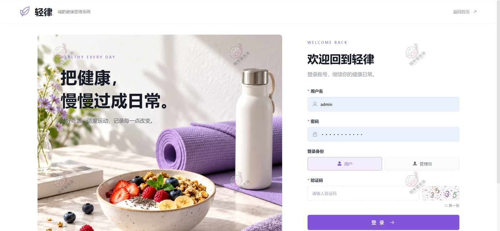

### 4.2 普通用户端

#### 首页

顶部导航是首页、健康记录、饮食与运动、健康知识、健康社区、我的空间。首屏 slogan「轻一点，也健康一点。」加一枚「开始健康记录」按钮；往下三个快捷入口（身体记录 / 每日计划 / 健康报告）；「健康管理工具」把全部功能分四组铺开——身体管理 5 项、饮食与计划 4 项、社区互动 4 项、我的账户 2 项。

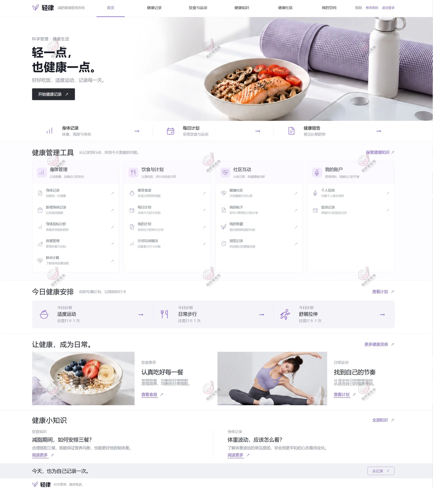

再往下是「今日健康安排」三张计划卡（适度运动、日常步行、舒展拉伸，各标「还需打卡 1 次」）和两条健康小知识——「减脂期间，如何安排三餐？」「体重波动，应该怎么看？」，这两条的标题与后台健康知识列表里的文章一一对应。

#### 身体记录

页面顶部三个小结数字：最近体重 62.5 kg、最近腰围 72.0 cm、最近记录 10 月 28 日。历史测量记录共 30 条，支持按日期区间查询，表格列是记录时间、体重、身高、BMI、腰围、血压、血糖，每行右侧可删除。

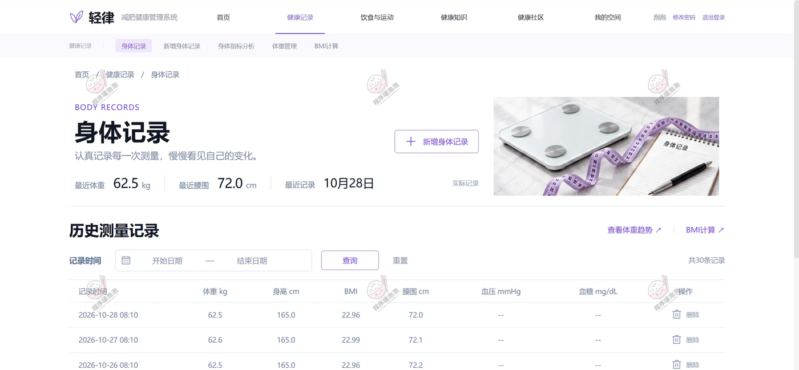

最近三行是 10 月 26 至 28 日的连续测量：62.5 / 62.6 / 62.5 kg，身高都是 165.0 cm，BMI 对应 22.96 / 22.99 / 22.96，腰围 72.0 / 72.1 / 72.2 cm，血压和血糖这两列是「--」——只填了体测项的记录也能存进历史。

#### 身体指标分析

顶部一行六个指标切换（体重 kg / 身高 cm / BMI / 血压 minHg / 血糖 mg/dL / 腰围 cm），分析周期选「最近 30 天」（2026-10-01 — 2026-10-30）。体重趋势图上方三个数字：最新记录 62.5 kg（10 月 28 日）、区间首条 64.0 kg（10 月 1 日）、记录变化 −1.5 kg。折线图从 10/01 到 10/29 缓降，未记录的日期按 0 处理并在图下注明。

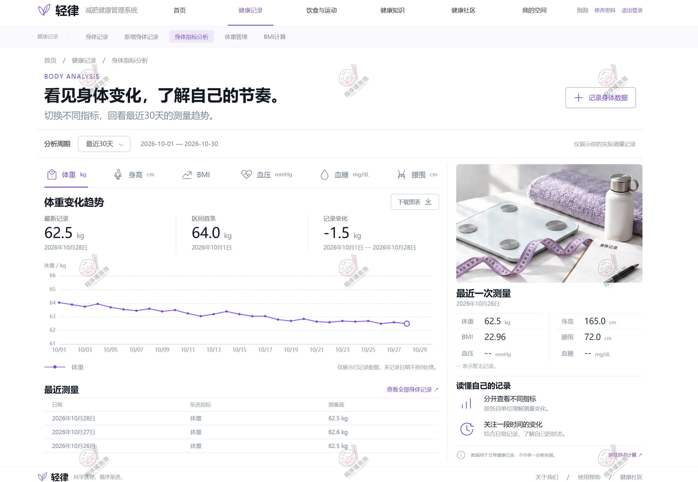

右侧「最近一次测量」卡片把 62.5 kg / 165.0 cm / BMI 22.96 / 腰围 72.0 cm 并排显示，血压血糖标注「暂无记录」；下方「读懂自己的记录」给出两条使用建议。图表右上有「下载报表」。

#### 体重管理

三个数字打头：最近一次体重 62.5 kg（记录于 2026 年 10 月 28 日）、目标体重 58.0 kg、距离目标 4.5 kg。下面同样是最近 30 天体重趋势折线，「最近记录」表列出 10 月 26–28 三条日常测量。

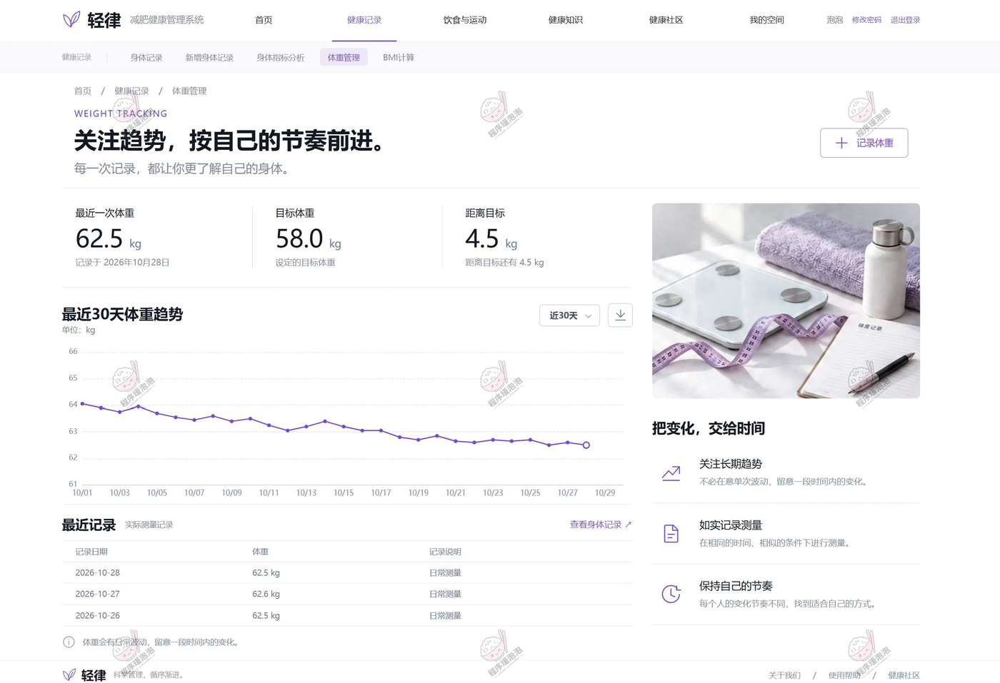

右侧栏「把变化，交给时间」提醒三件事：关注长期趋势、如实记录测量、保持自己的节奏。目标差值这一栏把减重这件事变成了一个能看见的数字。

#### BMI 计算

左侧是计算表单：体重（kg）与身高（cm）两个输入框加「计算 BMI」按钮，结果区显示 kg/m² 数值，下方附公式「BMI = 体重（kg）÷ 身高（m）²」。

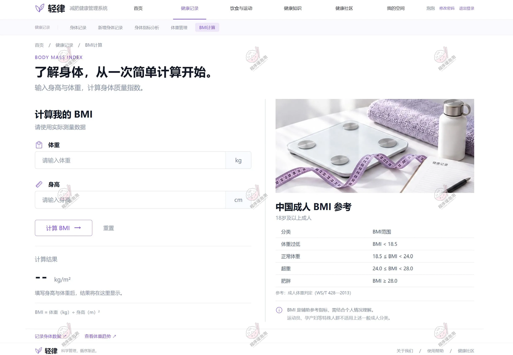

右侧「中国成人 BMI 参考」（18 岁及以上成人，参考 WS/T 428—2013）四行分类：体重过低 BMI < 18.5、正常体重 18.5 ≤ BMI < 24.0、超重 24.0 ≤ BMI < 28.0、肥胖 BMI ≥ 28.0。以身体记录里 62.5 kg / 165.0 cm 计算，BMI 22.96 落在正常体重区间，两页数据对得上。

#### 推荐食谱（饮食与运动）

标题是「好好吃饭，也是一种健康管理。」搜索框下面一排餐次筛选：全部食谱 / 早餐 / 午餐 / 晚餐。首条「今日食谱灵感」是香煎三文鱼能量碗（午餐 · 日常食谱），做法按三文鱼、杂粮饭、菌菇、紫薯、番茄的顺序写了一段，旁边提示「本食谱为系统功能演示内容」。

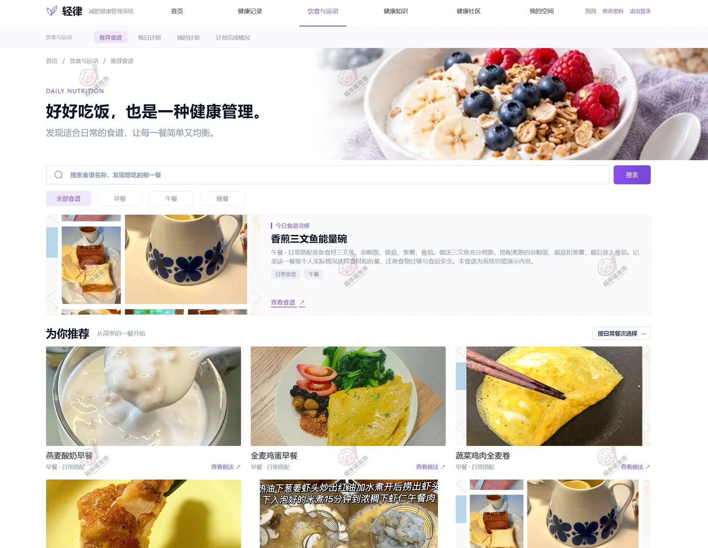

「为你推荐」区用卡片网格摆食谱，每张带餐次标签和「查看做法」入口：燕麦酸奶早餐、全麦鸡蛋早餐、蔬菜鸡肉全麦卷都是早餐 · 日常搭配。右上角还有「按日常餐次选择」下拉。

#### 每日计划

右上角日期卡写着 2026 年 10 月 30 日 · 星期五。进度条显示「0 / 6 项任务已完成」，右侧三个计数：全部任务 6、待完成 6、已完成 0。「我的今日计划」按状态筛选（全部 6 / 待完成 6 / 已完成 0），每张任务卡给出今日目标、注意事项、已打卡 0 次、剩余 1 次、最近打卡：暂无，右侧一枚「立即打卡」按钮。

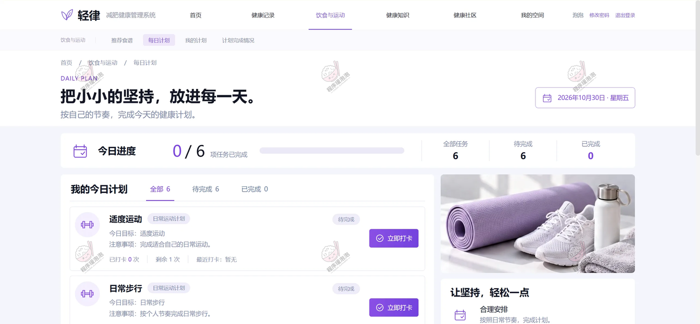

任务卡样例：适度运动（注意事项：完成适合自己的日常运动）、日常步行（按个人节奏完成日常步行）。同一批任务在管理后台的健康计划明细里能看到对应的打卡次数设置。

#### 我的计划

顶部一条汇总：全部计划 2 项、进行中 2 项、6 个目标。筛选按全部 / 进行中 / 未开始 / 已结束，另有「使用推荐计划」入口和搜索框。

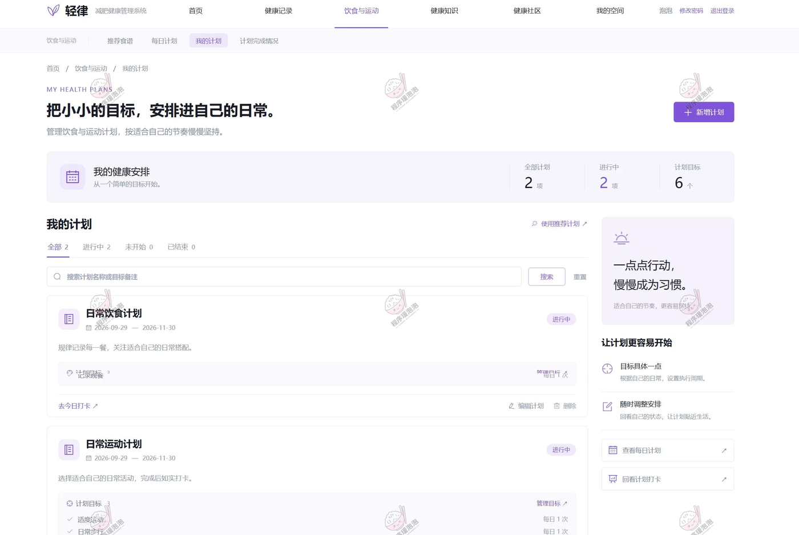

两张计划卡分别是「日常饮食计划」和「日常运动计划」，周期都是 2026-09-29 — 2026-11-30，状态标「进行中」。饮食计划下挂「记录餐食 每日 1 次」，运动计划下挂适度运动、日常步行等目标各每日 1 次，卡片底部是「去今日打卡 / 编辑计划 / 删除」三个入口。

#### 计划完成情况

三个汇总数字：参与计划 2 项、计划目标 6 项、累计打卡 50 次（标注为实际打卡统计）。日常运动计划累计打卡 26 次，横向条形图拆到任务：适度运动 12 次、日常步行 8 次、舒缓拉伸 6 次，图表可「下载图片」。

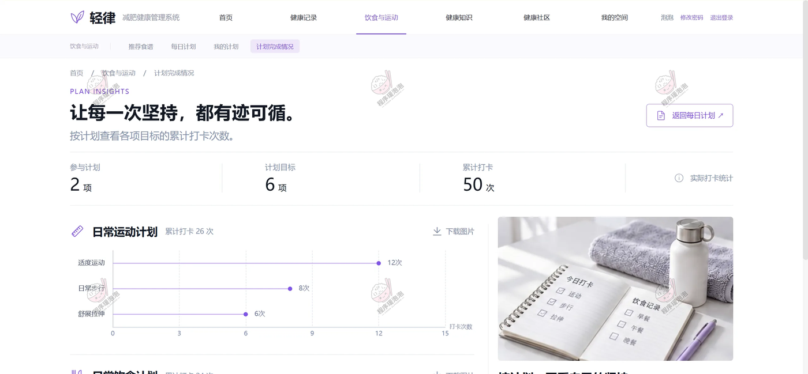

右上角「返回每日计划」按钮把回顾和执行接在同一条线上；页面下半部分还有日常饮食计划的同款统计图。

#### 健康知识

搜索框下面一排科普分类：全部 / 体重管理 / 健康习惯 / 心理科普 / 医学科普 / 运动科普 / 营养科普。精选阅读位是「每天学点营养学：认识膳食纤维」（营养科普 · 轻律演示项目），正文从全谷物、豆类、蔬果讲到膳食纤维的日常吃法。

下方「最新科普」按「最新发布」排序展示文章卡片，支持阅读详情、点赞和评论——后台知识列表里的「减脂期间…」「体重波动…」两篇就出现在这里。

#### 健康社区

二级标签是健康社区 / 我的帖子 / 我的收藏 / 浏览记录，内容区再分最新分享 / 热门话题 / 精选内容三个标签，右上角可搜索话题。帖子列表给出发帖人、时间、浏览数和评论数：「认真吃饭的一周，我的健康备餐日常」泡泡 2026-10-28 08:30:00、86 次浏览、0 条评论；「从每天多动一点开始，找到自己的节奏」2026-10-26 18:40:00、24 次浏览。

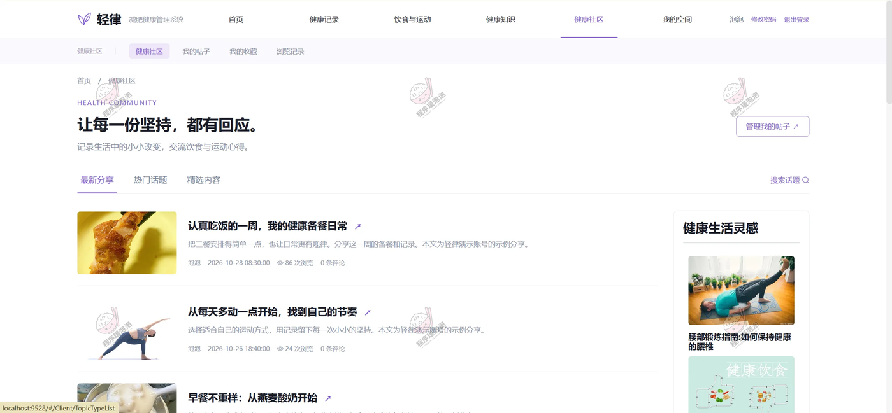

右侧「健康生活灵感」是推荐位（腰部锻炼指南、健康饮食）。这两条帖子在后台社区帖子管理里是同一组数据——浏览数 86 和 24 完全一致，状态都是「审核通过」。

### 4.3 管理员端

后台顶栏品牌是「轻律 管理工作台」，左侧管理导航分三层：管理首页、用户档案、首页轮播，内容类的营养食谱、健康计划、社区分类、社区帖子，以及互动类的互动评论、浏览足迹、收藏记录，最后是知识类的分类知识、健康知识。页面标题下方统一挂着一行引导语「清晰查看与维护内容，让每一次管理更加从容」。

#### 营养食谱

食谱表按名称、食谱内容（点开是内容浏览弹层）、推荐起始体重(kg)、推荐截止体重(kg)、封面、操作排列，支持新增与批量删除。演示数据里三条：燕麦酸奶早餐、香煎鸡胸轻食、鲜虾杂粮饭，体重区间都配了起止值。

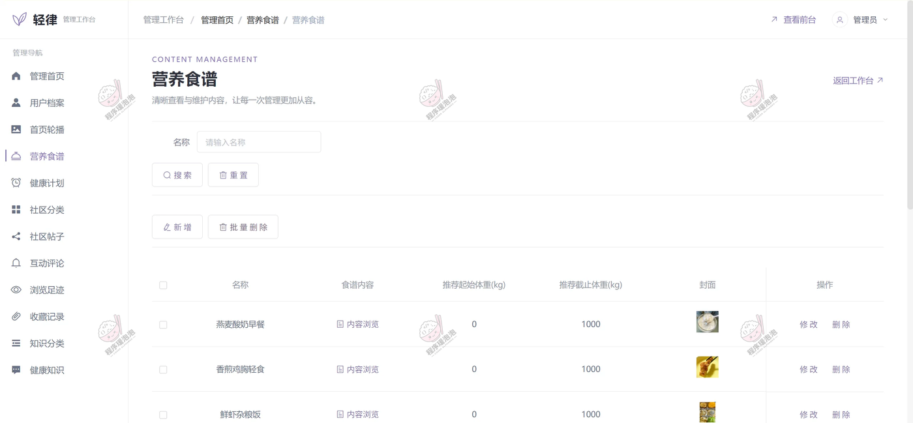

这两个体重区间字段就是「按体重区间推荐食谱」的配置处：用户最近一次体重落进哪个区间，前台就推哪一批食谱。

#### 健康计划

计划表一行一计划，列出计划名称、内容目标、开始日期、截止日期，右侧操作是编辑 / 维护详情 / 删除。行前的展开箭头点开后是任务明细表：主题、提醒内容、打卡次数。

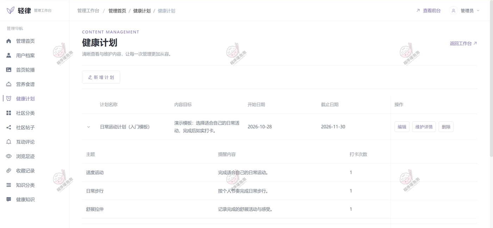

「日常运动计划（入门模板）」内容目标写着「演示模板：选择适合自己的日常活动，完成后如实打卡」，周期 2026-10-28 — 2026-11-30，明细三项——适度运动、日常步行、舒缓拉伸，各设打卡次数 1。这与用户端每日计划的任务、以及计划完成情况里「适度运动 12 / 日常步行 8 / 舒缓拉伸 6」的累计数是同一套任务体系。

#### 社区帖子

筛选支持标题、浏览数区间、交流类型。表格列有标题、交流类型、封面、浏览数、内容、是否推荐、审核状态、视频、操作（修改 / 删除）。

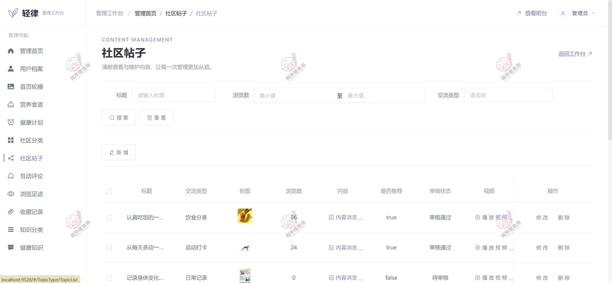

三条记录：「认真吃饭的一周…」饮食分享 86 浏览、是否推荐 true、审核通过；「从每天多动一点…」运动打卡 24 浏览、true、审核通过；「记录身体变化…」日常记录 0 浏览、false、待审批。前两条与用户端社区列表完全对应，第三条还压在待审批状态——发帖到展示要经过审核这一关。

#### 健康知识

知识表列出标题、类型、封面、发表者、评论数、点赞数、资讯内容、上架状态、操作（查看评论 / 修改 / 删除），支持新增与批量删除。

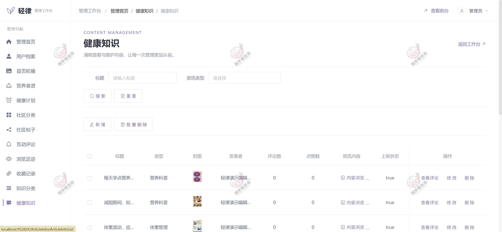

三条文章由「轻律演示编辑」发表：每天学点营养学（营养科普）、减脂期间如何…（营养科普）、体重波动应当…（体重管理），上架状态都是 true。后两条就是用户端健康小知识区里那两条「减脂期间，如何安排三餐？」「体重波动，应该怎么看？」的来源。

---

## 五、核心流程说明

**1. 身体记录与 BMI**
用户在健康记录模块录入体重、身高、腰围、血压、血糖，系统按记录时间留档。BMI 由体重除以身高（米）的平方得出，按 WS/T 428—2013 的中国成人分类对照区间；身体记录页的历史表和 BMI 计算页的参考表口径一致，62.5 kg / 165.0 cm 算出 22.96，落在「正常体重 18.5 ≤ BMI < 24.0」。

**2. 指标分析与体重管理**
身体指标分析支持六项指标切换，默认看最近 30 天，给出区间首条、最新记录和变化量三个数（64.0 → 62.5，−1.5 kg）；体重管理另设目标体重（58.0 kg），把「距离目标还有 4.5 kg」摆在数字卡上，趋势图与分析页共用同一份测量数据。

**3. 按体重区间推荐食谱**
后台维护食谱时填好推荐起始体重与截止体重，前台推荐食谱页按用户最近一次体重记录匹配区间生成「为你推荐」，再叠加搜索与早 / 午 / 晚餐次筛选。食谱详情给出做法内容，用户可按图索骥安排一日三餐。

**4. 健康计划与每日打卡**
管理员在健康计划里建计划并维护任务明细（主题、提醒内容、打卡次数），用户在「我的计划」里用推荐计划或自建计划，把官方任务挂进自己的周期。每天在「每日计划」页看待完成任务、点「立即打卡」，进度条从 0/6 往上走；「计划完成情况」按计划和任务统计累计打卡次数（运动计划 26 次 = 12 + 8 + 6，总累计 50 次），供回顾坚持情况。

**5. 定时邮件提醒**
Spring 定时任务每天检查当日未打卡的任务，给填写了邮箱的用户发送计划提醒，同时保存提醒记录、避免同一任务当日重复提醒。邮件服务需要单独配置后才生效。

**6. 社区内容审核与互动**
用户在健康社区发帖（带分类、封面、视频），帖子先进入后台社区帖子管理的「待审批」；管理员审核通过后才在前台展示，还可置顶推荐。前台浏览会累计浏览数并留下浏览足迹，评论、收藏同步进后台互动记录；「我的帖子 / 我的收藏 / 浏览记录」三个入口让用户管理自己的内容。

**7. 社区协同过滤推荐**
以话题浏览次数构建用户偏好数据，用余弦相似度找出兴趣相近的用户，把他们常看而当前用户没看过的话题排进推荐位；候选不足时回退到最新审核通过的话题。健康社区右侧的「健康生活灵感」与内容标签页的推荐内容都走这套逻辑。

---

## 六、说明

> 文档展示 16 张截图，需要了解更多，请联系我。
